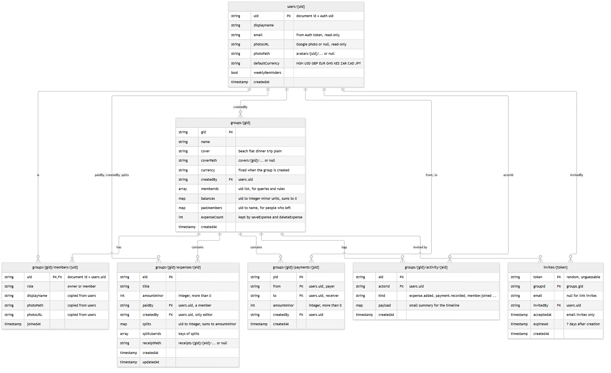

# SplitIt

A shared expense splitter: groups, expenses, balances and settle-up, built on Firebase. Money is always kept as whole numbers in each currency's smallest unit (kobo, cents, yen) and is never converted between currencies.

## Live site, and what it is

**Live site: https://YOUR-PROJECT.vercel.app** <!-- replace with the URL `vercel --prod` prints -->

The live site is the full app on free plans: sign up with email or Google, make groups, add expenses, record payments and settle up.

- **Firebase (Spark, free):** Authentication and Firestore, with `firestore.rules` and the indexes deployed by the Firebase CLI.
- **Vercel (Hobby, free):** the frontend and the server logic. The server logic used to be Firebase callable functions, which need the paid Blaze plan; it now runs as one Vercel function at `/api/<name>` (decision log 34).

Two things only exist in the local emulator version, and the site says so where they would be:

- **Photo uploads** (receipts, group covers, profile photos), because Firebase Storage needs Blaze. Covers use the illustrations and avatars use your Google photo or an illustration.
- **The weekly reminder email**, which isn't built.

To run everything locally, including uploads, see [Setup](#setup-from-a-clean-windows-machine). [DEMO.md](DEMO.md) walks through it, including trying to read a group you're not in, and `pnpm demo` runs the same steps one at a time for a screen recording.

## Contents

- [What runs where](#what-runs-where)
- [Setup from a clean Windows machine](#setup-from-a-clean-windows-machine)
- [Environment variables](#environment-variables)
- [Data model](#data-model)
- [How the security rules work](#how-the-security-rules-work)
- [The API](#the-api)
- [Settle-up](#settle-up)
- [Realtime design](#realtime-design)
- [The app, screen by screen](#the-app-screen-by-screen)
- [Tests](#tests)
- [Scripts](#scripts)
- [Deploying](#deploying)
- [Known limitations](#known-limitations)
- [Docs](#docs)

## What runs where

| Part                                        | Live site                                                     | Local (emulators)                      | How it's checked                                                                                            |
| ------------------------------------------- | ------------------------------------------------------------- | -------------------------------------- | ----------------------------------------------------------------------------------------------------------- |
| Frontend (React, Vite)                      | Vercel                                                        | `pnpm dev`                             | Vite dev server, which also serves the API at `/api` (against the emulators when `VITE_USE_EMULATORS=true`) |
| API: the 14 server calls (`server/`)        | Vercel function `api/[name].ts`, region `fra1` (Frankfurt)    | inside `pnpm dev`, same origin         | `pnpm test:api` (114 tests)                                                                                 |
| Authentication (email, Google)              | Firebase, Spark                                               | Auth emulator                          | every emulator suite                                                                                        |
| Firestore and `firestore.rules`             | Firebase, Spark, `europe-west3` (Frankfurt)                   | Firestore emulator                     | `pnpm test:rules` (126 tests with Storage)                                                                  |
| Composite index for `spendingByMonth`       | Deployed with the rules                                       | ignored: the emulator needs no indexes | **Only on the live site**: the dashboard chart loads                                                        |
| Storage and `storage.rules` (photo uploads) | **Not deployed** (needs Blaze). Uploads hidden, never called. | Storage emulator                       | `pnpm test:rules`, `pnpm test:api` (Storage on and off)                                                     |
| Weekly reminder email                       | Not built                                                     | Not built                              | n/a                                                                                                         |

Firestore and the Vercel function are in the same city, because each API call makes several Firestore round trips.

**How a write happens.** The browser never writes money data. It calls `POST /api/<name>` with its Firebase ID token. The function verifies the token with firebase-admin, validates the input with the same zod schema the form uses, re-checks membership and ownership, and writes in one Firestore transaction. Locally, `pnpm dev` serves the same `/api` from the same code (`server/http/handle.ts`), so the app, the seed and the tests all go through it.

> **The `spendingByMonth` composite index is only confirmed on the live site.** The dashboard's spending query (`splitUserIds` array-contains, ordered by `createdAt`) needs the index in [firestore.indexes.json](firestore.indexes.json). The emulator runs any query without indexes. The first time the chart loads on the live site, with at least one expense, is the check; until then, treat it as untested.

## Setup from a clean Windows machine

PowerShell, one command per line.

1. **Node 24**, from https://nodejs.org (the LTS installer). Vercel runs the API on Node 24 too (`engines` in package.json). Then turn on pnpm, which comes with Node:

   ```powershell
   corepack enable pnpm
   ```

2. **Java 21**, which the Firestore and Storage emulators need. Install it from https://adoptium.net (Temurin 21) and tick "Set JAVA_HOME". Open a new terminal and check:

   ```powershell
   java -version
   ```

3. **Firebase CLI:**

   ```powershell
   npm install -g firebase-tools
   ```

   ```powershell
   firebase --version
   ```

   You don't need `firebase login` for the emulators, because `demo-` projects don't use an account. You will need it to deploy:

   ```powershell
   firebase login
   ```

4. **The project:**

   ```powershell
   pnpm install
   ```

   ```powershell
   Copy-Item .env.example .env.local
   ```

5. **Run it.** In one terminal, start the emulators and wait for "All emulators ready":

   ```powershell
   pnpm emulators
   ```

   In a second terminal, start the app, which also serves the API:

   ```powershell
   pnpm dev
   ```

   In a third terminal, add the demo data. It goes through the API, so `pnpm dev` must be running:

   ```powershell
   pnpm seed
   ```

   The app is at http://localhost:5173 and the Emulator UI at http://127.0.0.1:4000. `pnpm seed` prints the demo logins.

   Have a `.env.local` from before the move to Vercel? Add `VITE_STORAGE_UPLOADS=true` to it, or copy `.env.example` again, to turn photo uploads back on locally.

> PowerShell tip: quote comma lists passed to the Firebase CLI, for example `firebase emulators:start --only "firestore,storage"`. Without quotes, PowerShell turns `firestore,storage` into an array.

## Environment variables

Vite reads `.env.local`, which git ignores. [.env.example](.env.example) lists every variable, with values that work for the emulators.

**Browser (public, `VITE_` prefix):** the Firebase web config. It ships to every browser by design and only identifies the project; Auth and the security rules protect the data.

| Variable                       | Emulators                     | Live (Vercel)                                  |
| ------------------------------ | ----------------------------- | ---------------------------------------------- |
| `VITE_FIREBASE_PROJECT_ID`     | `demo-splitit`                | the real project id                            |
| `VITE_FIREBASE_API_KEY`        | any value                     | from `firebase apps:sdkconfig web`             |
| `VITE_FIREBASE_AUTH_DOMAIN`    | any value                     | `<project>.firebaseapp.com`                    |
| `VITE_FIREBASE_APP_ID`         | any value                     | from `firebase apps:sdkconfig web`             |
| `VITE_FIREBASE_STORAGE_BUCKET` | `demo-splitit.appspot.com`    | not set (no Storage)                           |
| `VITE_USE_EMULATORS`           | `true`                        | not set                                        |
| `VITE_STORAGE_UPLOADS`         | `true` to offer photo uploads | not set (uploads hidden, Storage never called) |

**Server only (no `VITE_` prefix, never sent to the browser):**

| Variable                    | What it is                                                                                                                                          |
| --------------------------- | --------------------------------------------------------------------------------------------------------------------------------------------------- |
| `FIREBASE_SERVICE_ACCOUNT`  | Live only, set in Vercel as a sensitive variable: the service-account key JSON, base64-encoded. Leave it empty locally; the API uses the emulators. |
| `API_RATE_LIMIT_PER_MINUTE` | Optional. Calls per person per minute, per function instance (default 120).                                                                         |

**The service-account key is never in git or in client code.** Locally the API talks to the emulators and needs no key. The server refuses to start with both a key and emulator settings, with emulator settings on Vercel, or with an emulator project id that doesn't start with `demo-` (`server/admin.ts`).

## Data model



The full field list, and who can read and write each collection, is in [docs/data-model.md](docs/data-model.md) (diagram source: [docs/data-model.mmd](docs/data-model.mmd)).

In short:

- `users/{uid}`: your profile, readable only by you.
- `groups/{gid}`: name, currency, cover, `memberIds`, and `balances` (one integer per member, always summing to zero).
- `groups/{gid}/members/{uid}`: role, plus a copy of the member's name and photo so that group screens never read other people's profiles.
- `groups/{gid}/expenses/{eid}`: `amountMinor`, `paidBy`, `splits` (uid to minor units), `splitUserIds`.
- `groups/{gid}/payments/{pid}` and `groups/{gid}/activity/{aid}`: append-only.
- `invites/{token}`: the document id is the secret.

## How the security rules work

[firestore.rules](firestore.rules) and [storage.rules](storage.rules) follow one idea: **clients may read what belongs to groups they are in, and may write only their own profile.** Everything else is written by the API through the Admin SDK, which skips the rules, so every handler does its own checks.

### Helpers

- `isSignedIn()`: there is a signed-in user.
- `isMember(gid)`: `groups/{gid}/members/{your uid}` exists. This costs one document read. The member document's id is the uid, so `exists()` is enough.
- `isOwner(gid)`: that member document says `role == 'owner'` (one `get()`).
- `isSelf(uid)`: the document is yours.

### Each rule in plain words

| Path                                    | Read                                        | Write                                                                                                                                                                         |
| --------------------------------------- | ------------------------------------------- | ----------------------------------------------------------------------------------------------------------------------------------------------------------------------------- |
| `users/{uid}`                           | only you                                    | You create it once, on first sign-in, and its email and photo must match your sign-in. After that you can change only `defaultCurrency` and `weeklyReminders`. Never deleted. |
| `groups/{gid}`                          | if your uid is in its `memberIds`           | never (API only)                                                                                                                                                              |
| `groups/{gid}/members/*`                | members                                     | never: a client could otherwise make itself owner                                                                                                                             |
| `groups/{gid}/expenses/*`, `payments/*` | members                                     | never                                                                                                                                                                         |
| `groups/{gid}/activity/*`               | members                                     | never                                                                                                                                                                         |
| `invites/{token}`                       | the group's owner (to list pending invites) | never. People holding a link call `invitePreview`, which returns only the group's name and the inviter's name.                                                                |
| anything else                           | no                                          | no                                                                                                                                                                            |
| Storage `receipts/{gid}/{eid}/*`        | members                                     | Members upload JPEG, PNG or WebP under 5 MB. Nobody deletes (the API does).                                                                                                   |
| Storage `covers/{gid}/*`                | members                                     | the owner; images under 5 MB                                                                                                                                                  |
| Storage `avatars/{uid}/*`               | anyone (so avatars load everywhere)         | only you; images under 5 MB                                                                                                                                                   |

Group reads check `memberIds` on the document instead of calling `isMember()`. The groups list runs `where('memberIds', 'array-contains', uid)`, and Firestore only allows a query if it can prove the rule from the query itself (decision log 4). A group that doesn't exist and a group you aren't in are both refused the same way, so the app can't tell them apart, and neither can an attacker.

### Why clients can't write money data

If the browser could write balances or expenses, any member could set their own debt to zero or invent an expense, and no rule can work out whether a split adds up correctly or whether a payment exceeds what is owed. So:

- every expense, edit, delete and payment is an API call;
- the handler verifies the ID token and re-checks membership;
- its zod schema validates the input;
- it changes the balances by the difference, in the same Firestore transaction as the change.

The rules then just say `allow write: if false`, which is easy to read and to test.

### Run the rule tests

```powershell
pnpm test:rules
```

This starts the Firestore and Storage emulators, runs 126 checks and prints a pass/fail table. Among other things, they check that:

- an outsider can't read or write anything in another group;
- even an owner can't write members, balances or expenses directly;
- uploads must be small raster images, so SVG is refused;
- signed-out visitors get nothing.

To try it by hand in the browser, see [DEMO.md](DEMO.md).

## The API

The 14 calls that used to be callable Cloud Functions, now in [server/](server/) and served at `POST /api/<name>`:

- **On Vercel:** one function, [api/[name].ts](api/[name].ts). Hobby allows at most 12 functions per deployment.
- **Locally:** `pnpm dev`, the API tests and the seed serve the same code through [server/http/node.ts](server/http/node.ts).

Both end in [server/http/handle.ts](server/http/handle.ts), which:

- accepts POST with a JSON `{ data }` body of at most 32 KB;
- verifies the `Authorization: Bearer <Firebase ID token>` header with firebase-admin, including that the token is for this project;
- applies a per-person rate limit;
- answers `{ result }`, or `{ error: { code, message } }` with the same codes and HTTP statuses the callables used. Other errors become `internal`, without details.

The client ([src/lib/apiClient.ts](src/lib/apiClient.ts)) turns those back into `functions/<code>` errors, so the screens didn't change.

Each handler:

- requires sign-in;
- validates its input with a zod schema shared with the client forms ([server/shared/schemas.ts](server/shared/schemas.ts));
- re-checks membership and ownership with the Admin SDK;
- writes in a transaction, together with an activity entry.

| Call                                            | Does                                                                                                                                                                                                                              |
| ----------------------------------------------- | --------------------------------------------------------------------------------------------------------------------------------------------------------------------------------------------------------------------------------- |
| `createGroup`, `updateGroup`                    | New group with you as owner. Rename it or change the cover; an old uploaded cover is deleted (emulators only).                                                                                                                    |
| `createInvite`, `invitePreview`, `acceptInvite` | A reusable link (7 days) or a personal invite for one email. The preview shows only the group name and inviter. Accepting adds you to the members and to `memberIds` together.                                                    |
| `leaveGroup`, `removeMember`                    | Only with a zero balance. The last member to leave deletes the group.                                                                                                                                                             |
| `saveExpense`, `deleteExpense`                  | Splits must add up to the amount exactly, in integer minor units. Only the person who added the expense can change it. Balances move by the difference. Expenses involving someone who has left are frozen.                       |
| `recordPayment`                                 | Only the payer or receiver can record it. Inside the transaction, the amount is capped at the smaller of what the payer owes and what the receiver is owed, so two payments at the same moment can't overpay (tested with races). |
| `settleUp`                                      | Works out the plan (see below). Reads only.                                                                                                                                                                                       |
| `recomputeBalances`                             | Owner only. Rebuilds balances from every expense and payment, and corrects them if they differ.                                                                                                                                   |
| `spendingByMonth`                               | Your share (`splits[you]`) of expenses per month, per currency, in your time zone. Needs the composite index (see above).                                                                                                         |
| `updateProfile`                                 | Name and photo: updates `users/{uid}` and the copy on every `members` document, in batches. Deletes the old photo (emulators only).                                                                                               |

**Storage switch.** Storage is on only when `FIREBASE_STORAGE_EMULATOR_HOST` is set. On the live site a photo path is refused with `failed-precondition` and file clean-up is skipped, so no Storage call is ever made.

## Settle-up

Each group's balances are integers that add up to zero. The settle-up plan is worked out by the `settleUp` function; the browser only shows it. It is greedy: match whoever is owed the most with whoever owes the most, for the smaller of the two amounts, and repeat. Each payment clears at least one person, so n people need at most n − 1 payments. Ties are broken by uid, so everyone sees the same plan.

Finding the truly fewest payments is NP-hard: it means finding groups of people whose balances cancel out among themselves, which is a subset-sum problem. Greedy is fast, never needs more than n − 1 payments, and for real groups is usually optimal or one payment off.

The tests check that:

- the payments bring every balance to zero;
- every amount is a positive integer;
- there are at most n − 1 payments;
- ties give the same plan;
- people who have left are excluded.

Payments can be partial. They are pooled per person, so the limit is "what you owe overall", not "what you owe Ada" (see limitations).

## Realtime design

- **An open group has four `onSnapshot` listeners:** the group document (balances, members, name), its expenses, its payments and its activity, newest first and limited to 500, 500 and 50. They write straight into TanStack Query's cache, so every part of the page updates together.
- **No duplicate listeners.** A small reference-counted registry ([src/live/registry.ts](src/live/registry.ts)) starts a group's listeners once, however many components need them, and stops them when you leave the group's pages. In development, `window.__splitit.openListeners()` reports how many are open.
- **What you see.** New rows get a highlighter sweep. When someone else changes something, a short note names them. When balances change, the settle-up plan is fetched again.
- **Losing access.** If you are removed, or the group is deleted, while the page is open, the listeners are refused with `permission-denied`. The page then switches to "You're not in this group any more." instead of breaking.
- **Search (Ctrl+K or ⌘K) is client-side.** Firestore has no substring search, so the search box loads your groups and each one's latest 500 expenses into the browser and matches there, ignoring case and accents. It can only find what you can already read.
- **Offline.** A bar says when the browser is offline. Firestore keeps showing what it already loaded, but nothing can be saved, because every change goes through the API. The listeners catch up when the connection returns.

## The app, screen by screen

- **Sign-in:** email and password, or Google. Google uses a popup on desktop and a full-page redirect on touch screens. Signed-out visitors are sent to `/auth?next=…` and come back to where they were heading; `next` only accepts paths inside the app.
- **Dashboard:**
  - Tiles for what you owe, what you're owed and your net balance, one line per currency, never added across currencies.
  - Your spending per month.
  - Quick actions and your groups.
- **Group:**
  - The ledger, with each row showing your share.
  - Where everyone stands, and the settle-up plan.
  - Recent activity and the member list.
  - Invites, cover photo (emulators only), and leave or remove members.
- **Settle up:** one card per payment, with "Record payment" (if you pay) or "Mark as received" (if you're paid) for a full or partial payment.
- **Activity:** a timeline of all your groups, filterable.
- **Settings:**
  - Name and photo, which go through `updateProfile`.
  - Reminder setting, theme, default currency and log out.
  - Avatars show your uploaded photo (emulators only), then your Google photo, then an illustration chosen by a hash of your uid.

**Accessibility and polish:**

- Every dialog traps focus, closes on Esc and puts focus back on the button that opened it.
- There is a skip link, and every screen works by keyboard.
- Reduced-motion settings turn the animations off.
- Every screen has a dark theme, which follows the system until you choose one.
- Loading shows skeletons, failures show "Try again", and empty lists say what to do next.

**Bundle:** each signed-in screen is loaded the first time it's opened, and the big libraries (Firestore, Firebase, React, TanStack Query) get their own files. No file is over Vite's 500 kB warning. The Storage SDK is only loaded when a photo is uploaded or shown, so the live site never downloads it.

## Tests

| Command           | What it proves                                                                                                                                                                                                                                                                                                                                                                                  | Needs                                                   |
| ----------------- | ----------------------------------------------------------------------------------------------------------------------------------------------------------------------------------------------------------------------------------------------------------------------------------------------------------------------------------------------------------------------------------------------- | ------------------------------------------------------- |
| `pnpm test`       | Unit and component tests: money parsing, formatting and equal splits, balance arithmetic (with a 500-step random check), settle-up, chart scale, search, image checks. Components in jsdom: the route guard, the money input and the expense form's split totals.                                                                                                                               | nothing                                                 |
| `pnpm test:rules` | 126 checks on `firestore.rules` and `storage.rules` (see above)                                                                                                                                                                                                                                                                                                                                 | Java (starts Firestore and Storage emulators)           |
| `pnpm test:api`   | Every API call over HTTP, through the app's own API client with real Auth-emulator ID tokens: profile, groups, invites, membership, expenses (balances rebuilt from raw expenses after every change), payments (overpaying refused even when payments race), `spendingByMonth`, Storage switched off, and the HTTP layer (methods, body size, bad, expired or other-project tokens, rate limit) | Java (starts the Auth, Firestore and Storage emulators) |

The emulator suites start and stop their own emulators and print a pass/fail table. Stop `pnpm emulators` first, because the ports clash.

## Scripts

| Command          | What it does                                                                                                                                                               |
| ---------------- | -------------------------------------------------------------------------------------------------------------------------------------------------------------------------- |
| `pnpm dev`       | Vite dev server                                                                                                                                                            |
| `pnpm build`     | Typecheck and build the app to `dist/`. This is what Vercel runs; Vercel builds `api/[name].ts` itself.                                                                    |
| `pnpm typecheck` | TypeScript for the app, `server/`, `api/` and tests                                                                                                                        |
| `pnpm lint`      | ESLint (type-aware)                                                                                                                                                        |
| `pnpm format`    | Prettier                                                                                                                                                                   |
| `pnpm emulators` | Start the Auth, Firestore and Storage emulators and the Emulator UI                                                                                                        |
| `pnpm seed`      | Wipe the emulators and create 3 people and 2 groups (NGN and JPY) through the real API. Needs `pnpm dev` running. Refuses anything but local `demo-` emulators.            |
| `pnpm demo`      | Step-by-step DEMO.md for a screen recording. It seeds, opens each page and copies the DevTools snippet with this run's ids. Needs `pnpm emulators` and `pnpm dev` running. |
| `pnpm diagram`   | Re-render `docs/data-model.png` from `docs/data-model.mmd` (uses your installed Chrome)                                                                                    |

## Deploying

Everything stays on free plans.

- **Firebase (Spark):** create the project and the Firestore database in `europe-west3`, turn on email and Google sign-in, then deploy the rules and the index:

  ```powershell
  firebase deploy --only "firestore:rules,firestore:indexes" --project YOUR-PROJECT-ID
  ```

- **Vercel (Hobby):** [vercel.json](vercel.json):
  - installs with pnpm 11 and runs `pnpm build`;
  - serves `dist/`;
  - runs `api/[name].ts` as one function in `fra1`, with a 30-second limit;
  - sends every other path to `index.html`.

  [.vercelignore](.vercelignore) keeps local `.env` files and emulator data out of the upload.

- **Settings on Vercel:** the `VITE_FIREBASE_*` web config, and `FIREBASE_SERVICE_ACCOUNT` as a sensitive variable.
- **Authorised domains:** add the Vercel domain under Authentication → Settings → Authorized domains. Google sign-in only works on domains listed there (decision log 11).

## Known limitations

- **No photo uploads on the live site.** Receipts, covers and profile photos need Firebase Storage, which needs Blaze. They work locally on the emulators.
- **The `spendingByMonth` composite index is unconfirmed until the chart loads on the live site** (see [What runs where](#what-runs-where)).
- **Abuse protection is light.** Each person gets a call limit per minute, but every Vercel instance counts separately. The real backstop is Spark's daily free quota: someone hammering the API could use up the day's free Firestore writes, after which writes fail until the quota resets. Spark never bills, so the risk is downtime, not cost.
- **Expenses involving someone who left are frozen.** You can only leave with a zero balance, but your name stays on old expenses. Editing or deleting one would give you a balance after you'd gone, with no way to settle it, so both are refused, and the ledger says why. To change one, that person has to rejoin first.
- **A receipt can be left behind in Storage (emulators).** The photo is uploaded before the expense is saved, and the save checks that it exists. If the upload works but the save fails, the photo stays with nothing pointing to it. Clients can't delete receipts, so cleaning these up would need a scheduled job. Replacing or removing a receipt through the app does delete the old file.
- **Payments are pooled per person.** "What Bayo owes Ada" isn't stored. The limit for a payment is the smaller of what the payer owes and what the receiver is owed overall.
- **Settle-up is greedy**, not guaranteed minimal (see above).
- **No email is sent.** You send invite links yourself. The weekly reminder setting is saved, but nothing sends the email yet: that needs a scheduled job and an email service that works without a verified domain.
- **Long histories are cut off.**
  - The ledger shows a group's latest 500 expenses and 500 payments, so in a big group its "Total spent" covers only those.
  - Balances are always complete, because they're stored, not added up in the browser.
  - The Activity page shows the latest 50 entries per group.
- **The spending chart uses the date an expense was added**, because there is no separate "date spent".
- **Search only covers what is loaded:** your groups and their latest 500 expenses each.
- **Offline, nothing can be saved.** The app says so, rather than queueing changes.

## Docs

- [DEMO.md](DEMO.md): run it locally and try to read another group's data
- [Plan for the move to Vercel](docs/vercel-migration-plan.md)
- [Data model and access table](docs/data-model.md)
- [Decision log](docs/decision-log.md)
- Rules: [firestore.rules](firestore.rules), [storage.rules](storage.rules)
