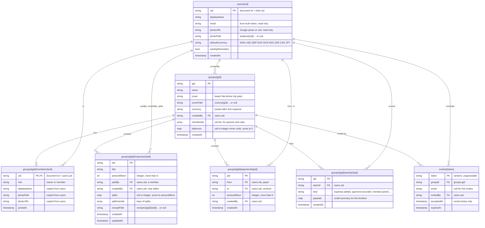

# SplitIt data model

Cloud Firestore, region `europe-west1`. A PNG of the diagram for printing is in [data-model.png](data-model.png). The diagram source is [data-model.mmd](data-model.mmd); run `pnpm diagram` after changing it.

## Three ideas behind the model

1. **Almost everything lives under a group.** Expenses, payments, members and activity are subcollections of `groups/{gid}`. One rule check, "is there a member document for me in this group?", protects all of them.
2. **Clients read, functions write.** The browser may write only its own `users/{uid}` document. Every change to a group (creating it, joining, adding an expense, recording a payment) goes through a callable Cloud Function. The function uses the Admin SDK and does all its checks inside one transaction.
3. **Money is whole numbers.** Every amount is an integer in the currency's smallest unit: kobo, cents, pence, or yen (yen has no smaller unit). There are no floats anywhere. Each group has a single currency, and amounts in different currencies are never added together.

## Diagram

## Who can read and write what

"Functions only" means no browser can write it directly, not even the group owner. The rules deny the write. The callable function writes it with the Admin SDK after checking the request.

| Collection                    | Who can read                                       | Who can write                                                                                                                                                                                                                                                                                                                                                             |
| ----------------------------- | -------------------------------------------------- | ------------------------------------------------------------------------------------------------------------------------------------------------------------------------------------------------------------------------------------------------------------------------------------------------------------------------------------------------------------------------- |
| `users/{uid}`                 | Only you.                                          | You create it on first sign-in (`email` and `photoURL` must match your sign-in; no uploaded photo yet). Afterwards you can change `defaultCurrency` and `weeklyReminders` directly. `displayName` and `photoPath` change only through the `updateProfile` function, because they are copied onto your member documents. `email`, `photoURL` and `createdAt` never change. |
| `groups/{gid}`                | Members of the group (your uid is in `memberIds`). | Functions only. `balances` changes only inside the expense and payment functions, in the same transaction as the expense or payment.                                                                                                                                                                                                                                      |
| `groups/{gid}/members/{uid}`  | Members of the same group.                         | Functions only: `createGroup`, `acceptInvite`, `leaveGroup`, `removeMember`, and `updateProfile` for the copied name and photo. A client writing here could promote itself to owner.                                                                                                                                                                                      |
| `groups/{gid}/expenses/{eid}` | Members of the group.                              | Functions only: `saveExpense`, `deleteExpense`. Each checks that you are a member, the payer and everyone in the split are members, and the splits add up exactly to the amount. Only the person who created an expense can edit or delete it.                                                                                                                            |
| `groups/{gid}/payments/{pid}` | Members of the group.                              | Functions only: `recordPayment`. A payment can't be more than the payer owes, and it is never edited or deleted.                                                                                                                                                                                                                                                          |
| `groups/{gid}/activity/{aid}` | Members of the group.                              | Functions only. Written in the same transaction as the change it describes.                                                                                                                                                                                                                                                                                               |
| `invites/{token}`             | The group's owner, to list pending invites.        | Functions only: `createInvite`, `acceptInvite`. People opening a link never read this collection; the join screen calls `invitePreview(token)`, which returns only the group name and the inviter's name.                                                                                                                                                                 |
| Anything else                 | Nobody.                                            | Nobody (default deny).                                                                                                                                                                                                                                                                                                                                                    |

Signed-out visitors can read nothing in Firestore.

### Files (Cloud Storage)

| Path                          | Who can read          | Who can write                                                                              |
| ----------------------------- | --------------------- | ------------------------------------------------------------------------------------------ |
| `receipts/{gid}/{eid}/{file}` | Members of the group. | Members of the group. JPEG, PNG or WebP only, under 5 MB. Deleted only by `deleteExpense`. |
| `avatars/{uid}/{file}`        | Anyone.               | Only you, in your own folder. Image, under 5 MB.                                           |
| `covers/{gid}/{file}`         | Members of the group. | The group's owner. Image, under 5 MB.                                                      |

## Notes for the review

- **No access looks the same as not found.** If you ask for a group you are not in, or one that doesn't exist, Firestore fails the request with `permission-denied`. It does not return an empty result. The app shows the same "You're not in this group" screen in both cases, so nobody can probe which group ids exist.
- **`memberIds` and `members` are both kept.** `memberIds` on the group document lets the Groups page run one query (`where memberIds array-contains me`) and lets the group rule check membership with no extra reads. The `members/{uid}` documents hold each person's role and display name, and let subcollection rules check membership with one `exists()`. Functions update both in the same transaction.
- **Names and photos are copied onto `members`.** That way the group screens never read other people's `users` documents, and email addresses stay private. When you change your name or photo, the `updateProfile` function updates your profile and the copy in each group you are in.
- **Splits are a map inside the expense** (`{ uid: amountMinor }`), so there is no separate splits collection. `splitUserIds` repeats the map's keys so expenses can be queried by person.
- **Each rule check costs at most one document read**, well under the limit of 10 document accesses per request.

## Changes from the prototype's Data model page

| Prototype                                    | Here                                                      | Why                                                                                                                                                                                       |
| -------------------------------------------- | --------------------------------------------------------- | ----------------------------------------------------------------------------------------------------------------------------------------------------------------------------------------- |
| `users.photoURL` only                        | `photoURL` (Google, read-only) and `photoPath` (uploaded) | The brief lists `photoPath`. Avatars use the upload first, then the Google photo, then the illustrated fallback, so both are needed.                                                      |
| `users` has no settings                      | adds `defaultCurrency`, `weeklyReminders`                 | From the brief: the Settings page and the weekly email need them.                                                                                                                         |
| `users` readable by people who share a group | readable only by yourself                                 | Rules can't check "do we share a group?" without knowing which group, and the check would cost several reads. Copying name and photo onto `members` avoids this and keeps emails private. |
| `members` has `role`, `joinedAt`             | adds `displayName`, `photoPath`, `photoURL`               | The copies described in the row above.                                                                                                                                                    |
| `groups` without `coverPath`                 | adds `coverPath`                                          | Uploaded cover photos.                                                                                                                                                                    |
| `expenses` without `updatedAt`               | adds `updatedAt`                                          | Edits are allowed, so the edit time is recorded.                                                                                                                                          |
| `payments` without `createdBy`               | adds `createdBy`                                          | The payer and the person who recorded the payment can be different people.                                                                                                                |
